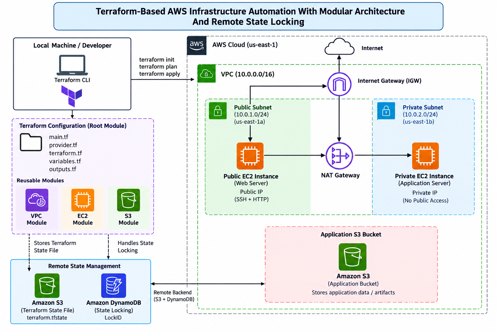
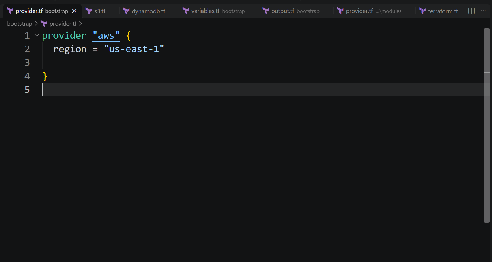
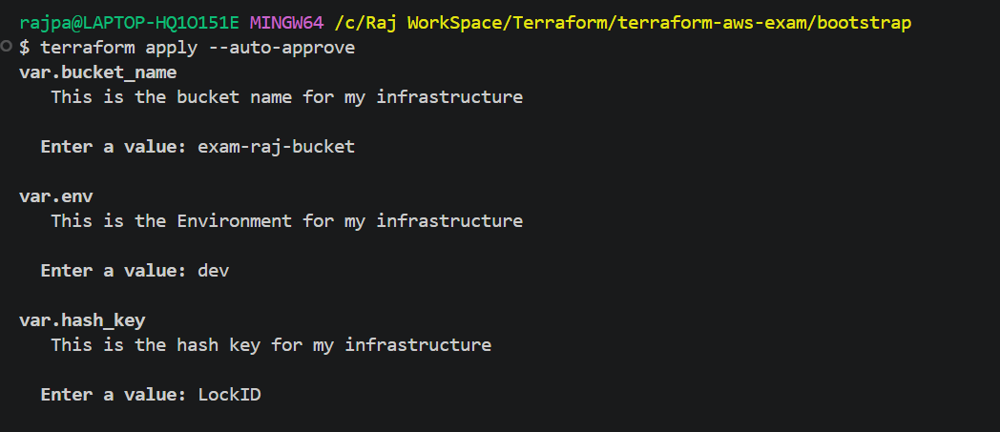

# Terraform-Based AWS Infrastructure Automation With Modular Architecture And Remote State Locking

# **Project Overview**

This project demonstrates how to provision AWS infrastructure using Terraform and a modular Infrastructure As Code approach. The configuration separates reusable VPC, EC2, and S3 resources into modules and uses variables and outputs to make the configuration easier to reuse and maintain.

The project also configures remote Terraform state storage in Amazon S3 and state locking through Amazon DynamoDB. The network design includes a VPC with one public subnet and one private subnet, an Internet Gateway, a NAT Gateway, and public and private EC2 instances.

# **Project Objectives**

- Automate AWS resource provisioning with Terraform.
- Organize infrastructure code into reusable VPC, EC2, and S3 modules.
- Create public and private subnet networking with route tables.
- Deploy EC2 instances with security groups and SSH access restricted to a trusted CIDR
- Store Terraform state remotely in Amazon S3.
- Use DynamoDB state locking to help prevent concurrent state modifications.
- Use variables and outputs to make configuration values reusable and resource details easy to retrieve.

# Architecture



# 1. Bootstrap

### 1. Provider.tf

```jsx
provider "aws" {
  region = "us-east-1"
}
```



### 2. DynamoDB.tf

```jsx
resource "aws_dynamodb_table" "exam-dynamodb" {
  name         = "${var.env}-exam-table"
  billing_mode = "PAY_PER_REQUEST"
  hash_key     = var.hash_key

  attribute {
    name = var.hash_key
    type = "S"
  }
  tags = {
    Name        = "${var.env}-exam-table"
    Environment = "${var.env}"
  }
}
```


### 3. S3.tf

```jsx
resource "aws_s3_bucket" "main-bucket" {
  bucket        = "${var.env}-${var.bucket_name}"
  force_destroy = true
  tags = {
    Name        = "${var.env}-${var.bucket_name}"
    Environment = "${var.env}"
  }
}
```


### 4. Variables.tf

```jsx
variable "env" {
  description = " This is the Environment for my infrastructure"
  type        = string
}
variable "hash_key" {
  description = " This is the hash key for my infrastructure"
  type        = string
}
variable "bucket_name" {
  description = " This is the bucket name for my infrastructure"
  type        = string
}
```


### 5. Output.tf

```jsx
output "state_bucket_name" {
  description = "S3 Bucket Used For Terraform State"
  value       = aws_s3_bucket.terraform_state.bucket
}

output "lock_table_name" {
  description = "DynamoDB Table Used For State Locking"
  value       = aws_dynamodb_table.terraform_lock.name
}
```


## 2. initialize Backend

## Command Run

### 1. Initialize Terraform

Downloads The Required AWS Provider And Initializes The Working Directory.

```jsx
terraform init
```


### 2. Validate Configuration

Checks Your Terraform Files For Syntax And Configuration Errors.

```jsx
terraform validate
```


### 3. Preview Changes

Shows What Terraform Intends To Create, Modify, Or Delete Without Applying The Changes.

```jsx
terraform plan
```

var.bucket_name

```jsx
exam_bucket_raj
```

var.env

```jsx
dev
```

var.hash_key

```jsx
LockID
```


### 4. Apply Configuration

Automatically Applies The Terraform Plan Without Asking For Confirmation.

```jsx
terraform apply --auto-approve
```

var.bucket_name

```jsx
exam_bucket_raj
```

var.env

```jsx
dev
```

var.hash_key

```jsx
LockID
```




### 5. Verify On AWS Console

### DynamoDB


### S3


# 2. Modules

## 2.1 EC2

### 1. Main.tf

```jsx
resource "aws_instance" "exam_ec2_instance" {
  ami                         = var.ami
  instance_type               = var.instance_type
  key_name                    = aws_key_pair.exam_ec2_key.key_name
  subnet_id                   = var.subnet_id
  vpc_security_group_ids      = [aws_security_group.exam_ec2_sg.id]
  associate_public_ip_address = var.associate_public_ip

  tags = {
    Name        = "${var.env}-exam-ec2-instance"
    Environment = var.env
  }
}

resource "aws_key_pair" "exam_ec2_key" {
  key_name   = "${var.env}-exam-ec2-key"
  public_key = file("${path.module}/exam-ec2-key.pub")

  tags = {
    Name = "${var.env}-exam-ec2-key"
  }
}

resource "aws_security_group" "exam_ec2_sg" {
  name        = "${var.env}-exam-ec2-sg"
  description = "Security Group For Public Web Server"
  vpc_id      = var.vpc_id

  ingress {
    description = "SSH From Trusted IP Only"
    from_port   = 22
    to_port     = 22
    protocol    = "tcp"
    cidr_blocks = [var.ssh_trusted_cidr]
  }

  ingress {
    description = "HTTP Access"
    from_port   = 80
    to_port     = 80
    protocol    = "tcp"
    cidr_blocks = ["0.0.0.0/0"]
  }

  egress {
    from_port   = 0
    to_port     = 0
    protocol    = "-1"
    cidr_blocks = ["0.0.0.0/0"]
  }

  tags = {
    Name = "${var.env}-exam-ec2-sg"
  }
}

```


### 2. Output.tf

```jsx
output "instance_id" {
  description = "Public EC2 Instance ID"
  value       = aws_instance.exam_ec2_instance.id
}

output "public_ip" {
  description = "Public IP Address Of The Web Server"
  value       = aws_instance.exam_ec2_instance.public_ip
}

output "security_group_id" {
  description = "Security Group ID Of The Web Server"
  value       = aws_security_group.exam_ec2_sg.id
}

output "key_pair_name" {
  description = "Registered AWS Key Pair Name"
  value       = aws_key_pair.exam_ec2_key.key_name
}
```


### 3 Variables.tf

```jsx
variable "env" {
  description = "Environment Name"
  type        = string
}

variable "ami" {
  description = "AMI ID For The EC2 Instance"
  type        = string
}

variable "instance_type" {
  description = "EC2 Instance Type"
  type        = string
  default     = "t2.micro"
}

variable "vpc_id" {
  description = "VPC ID For The EC2 Security Group"
  type        = string
}

variable "ssh_trusted_cidr" {
  description = "Trusted Public IP CIDR For SSH Access"
  type        = string
}
variable "subnet_id" {
  description = "Subnet ID Where The EC2 Instance Will Be Created"
  type        = string
}

variable "associate_public_ip" {
  description = "Whether To Associate A Public IP Address"
  type        = bool
  default     = false
}

variable "is_public" {
  description = "Whether This EC2 Instance Is Public"
  type        = bool
  default     = false
}

```


## 2.2 S3

### 1. Main.tf

```jsx
resource "aws_s3_bucket" "exam_bucket" {
  bucket        = "${var.env}-${var.bucket_name}"
  force_destroy = true
  tags = {
    Name        = "${var.env}-${var.bucket_name}"
    Environment = var.env
  }
}
```


### 2. Output.tf

```jsx
output "bucket_name" {
  description = "Name Of The Application S3 Bucket"
  value       = aws_s3_bucket.exam_bucket.bucket
}

output "bucket_arn" {
  description = "ARN Of The Application S3 Bucket"
  value       = aws_s3_bucket.exam_bucket.arn
}

output "bucket_id" {
  description = "ID Of The Application S3 Bucket"
  value       = aws_s3_bucket.exam_bucket.id
}
```


### 3. Variables.tf

```jsx
variable "env" {
  description = " This is the Environment for my infrastructure"
  type        = string
}
variable "bucket_name" {
  description = " This is the bucket name for my infrastructure"
  type        = string
}
```


## 2.2 VPC

### 1. Main.tf

```jsx
resource "aws_vpc" "this" {
  cidr_block           = var.vpc_cidr
  enable_dns_hostnames = true
  enable_dns_support   = true
  tags                 = { Name = "${var.project_name}-vpc" }
}

resource "aws_internet_gateway" "this" {
  vpc_id = aws_vpc.this.id
  tags   = { Name = "${var.project_name}-igw" }
}

resource "aws_subnet" "public" {
  vpc_id                  = aws_vpc.this.id
  cidr_block              = var.public_subnet_cidr
  availability_zone       = var.public_availability_zone
  map_public_ip_on_launch = true
  tags                    = { Name = "${var.project_name}-public" }
}

resource "aws_subnet" "private" {
  vpc_id                  = aws_vpc.this.id
  cidr_block              = var.private_subnet_cidr
  availability_zone       = var.private_availability_zone
  map_public_ip_on_launch = false
  tags                    = { Name = "${var.project_name}-private" }
}

resource "aws_eip" "nat" {
  domain = "vpc"
  tags   = { Name = "${var.project_name}-nat" }
}

resource "aws_nat_gateway" "this" {
  allocation_id = aws_eip.nat.id
  subnet_id     = aws_subnet.public.id
  tags          = { Name = "${var.project_name}-nat" }

  depends_on = [aws_route_table_association.public]
}

resource "aws_route_table" "public" {
  vpc_id = aws_vpc.this.id

  route {
    cidr_block = "0.0.0.0/0"
    gateway_id = aws_internet_gateway.this.id
  }

  tags = { Name = "${var.project_name}-public" }
}

resource "aws_route_table_association" "public" {
  subnet_id      = aws_subnet.public.id
  route_table_id = aws_route_table.public.id
}

resource "aws_route_table" "private" {
  vpc_id = aws_vpc.this.id
  tags   = { Name = "${var.project_name}-private" }
}

resource "aws_route" "private_nat" {
  route_table_id         = aws_route_table.private.id
  destination_cidr_block = "0.0.0.0/0"
  nat_gateway_id         = aws_nat_gateway.this.id
}

resource "aws_route_table_association" "private" {
  subnet_id      = aws_subnet.private.id
  route_table_id = aws_route_table.private.id
}
```


### 2. Output.tf

```jsx
output "vpc_id" {
  value = aws_vpc.this.id
}

output "public_subnet_id" {
  value = aws_subnet.public.id
}

output "private_subnet_id" {
  value = aws_subnet.private.id
}

output "public_availability_zone" {
  value = aws_subnet.public.availability_zone
}

output "private_availability_zone" {
  value = aws_subnet.private.availability_zone
}

output "nat_gateway_id" {
  value = aws_nat_gateway.this.id
}
```


### 3. Variables.tf

```jsx
variable "project_name" {
  type        = string
  description = "Resource name prefix."
}

variable "vpc_cidr" {
  type        = string
  description = "VPC IPv4 CIDR."
}

variable "public_subnet_cidr" {
  type        = string
  description = "Public subnet IPv4 CIDR."
}

variable "private_subnet_cidr" {
  type        = string
  description = "Private subnet IPv4 CIDR."
}

variable "public_availability_zone" {
  type        = string
  description = "Availability Zone for the public subnet and NAT Gateway."
}

variable "private_availability_zone" {
  type        = string
  description = "Availability Zone for the private subnet."
}

variable "ssh_trusted_cidr" {
  type        = string
  description = "Optional trusted IPv4 CIDR for SSH."
}

variable "tags" {
  type        = map(string)
  description = "Common resource tags."
}
```


# 3. Main

### 1. Main.tf

```jsx
module "vpc" {
  source = "./modules/vpc"

  project_name              = var.project_name
  vpc_cidr                  = var.vpc_cidr
  public_subnet_cidr        = var.public_subnet_cidr
  private_subnet_cidr       = var.private_subnet_cidr
  public_availability_zone  = var.public_availability_zone
  private_availability_zone = var.private_availability_zone
  ssh_trusted_cidr          = var.ssh_trusted_cidr
  tags                      = var.tags
}

module "ec2_public" {
  source = "./modules/ec2"

  env                 = "dev"
  ami                 = var.ami_id
  instance_type       = var.instance_type
  vpc_id              = module.vpc.vpc_id
  subnet_id           = module.vpc.public_subnet_id
  associate_public_ip = true
  is_public           = true
  ssh_trusted_cidr    = var.ssh_trusted_cidr
}

module "ec2_private" {
  source = "./modules/ec2"

  env                 = "prod"
  ami                 = var.ami_id
  instance_type       = var.instance_type
  vpc_id              = module.vpc.vpc_id
  subnet_id           = module.vpc.private_subnet_id
  associate_public_ip = false
  is_public           = false
  ssh_trusted_cidr    = var.ssh_trusted_cidr
}

module "s3" {
  source = "./modules/s3"

  env         = "dev"
  bucket_name = var.app_bucket_name
}

```


### 2. Provider.tf

```jsx
provider "aws" {
  region = "us-east-1"

}
```


### 3. Terraform.tf

```jsx
terraform {
  required_providers {
    aws = {
      source  = "hashicorp/aws"
      version = "6.70.0"
    }
  }
 
}
```


### 4. Variables.tf

```jsx
variable "aws_region" {
  description = "AWS Region For The Infrastructure"
  type        = string
  default     = "us-east-1"
}

variable "project_name" {
  description = "Project Name Used As A Resource Name Prefix"
  type        = string
  default     = "terraform-exam"
}

variable "vpc_cidr" {
  description = "VPC IPv4 CIDR Block"
  type        = string
  default     = "10.0.0.0/16"
}

variable "public_subnet_cidr" {
  description = "Public Subnet IPv4 CIDR Block"
  type        = string
  default     = "10.0.1.0/24"
}

variable "private_subnet_cidr" {
  description = "Private Subnet IPv4 CIDR Block"
  type        = string
  default     = "10.0.2.0/24"
}

variable "public_availability_zone" {
  description = "Availability Zone For The Public Subnet"
  type        = string
  default     = "us-east-1a"
}

variable "private_availability_zone" {
  description = "Availability Zone For The Private Subnet"
  type        = string
  default     = "us-east-1b"
}

variable "ssh_trusted_cidr" {
  description = "Trusted Public IPv4 CIDR Allowed To Access SSH"
  type        = string

  validation {
    condition     = can(cidrhost(var.ssh_trusted_cidr, 0))
    error_message = "Provide A Valid IPv4 CIDR, Such As Your_Public_IP/32."
  }
}

variable "tags" {
  description = "Common Tags Applied To AWS Resources"
  type        = map(string)
  default = {
    Environment = "dev"
    Project     = "terraform-exam"
    ManagedBy   = "Terraform"
  }
}

variable "ami_id" {
  description = "AMI ID For EC2 Instances In The Selected Region"
  type        = string
}

variable "instance_type" {
  description = "EC2 Instance Type"
  type        = string
  default     = "t3.micro"
}

variable "key_name" {
  description = "Name Of The EC2 SSH Key Pair Registered In AWS"
  type        = string
}

variable "app_bucket_name" {
  description = "Globally Unique Name For The Application S3 Bucket"
  type        = string
}

variable "state_bucket_name" {
  description = "Existing S3 Bucket Used For Terraform Remote State"
  type        = string
}

variable "lock_table_name" {
  description = "Existing DynamoDB Table Used For Terraform State Locking"
  type        = string
  default     = "dev-exam-table"
}

```


### 5. Output.tf

```jsx
# VPC Outputs

output "vpc_id" {
  description = "ID Of The Created VPC"
  value       = module.vpc.vpc_id
}

output "public_subnet_id" {
  description = "ID Of The Public Subnet"
  value       = module.vpc.public_subnet_id
}

output "private_subnet_id" {
  description = "ID Of The Private Subnet"
  value       = module.vpc.private_subnet_id
}

output "nat_gateway_id" {
  description = "ID Of The NAT Gateway"
  value       = module.vpc.nat_gateway_id
}

# Public EC2 Outputs

output "public_instance_id" {
  description = "ID Of The Public EC2 Instance"
  value       = module.ec2_public.instance_id
}

output "public_instance_ip" {
  description = "Public IPv4 Address Of The Public EC2 Instance"
  value       = module.ec2_public.public_ip
}

output "public_security_group_id" {
  description = "Security Group ID Of The Public EC2 Instance"
  value       = module.ec2_public.security_group_id
}

output "public_key_pair_name" {
  description = "Key Pair Name Used By The Public EC2 Instance"
  value       = module.ec2_public.key_pair_name
}

# Private EC2 Outputs

output "private_instance_id" {
  description = "ID Of The Private EC2 Instance"
  value       = module.ec2_private.instance_id
}

output "private_instance_private_ip" {
  description = "Private IPv4 Address Of The Private EC2 Instance"
  value       = module.ec2_private.private_ip
}

output "private_security_group_id" {
  description = "Security Group ID Of The Private EC2 Instance"
  value       = module.ec2_private.security_group_id
}

output "private_key_pair_name" {
  description = "Key Pair Name Used By The Private EC2 Instance"
  value       = module.ec2_private.key_pair_name
}

# Application S3 Outputs

output "app_bucket_name" {
  description = "Name Of The Application S3 Bucket"
  value       = module.s3.bucket_name
}

output "app_bucket_arn" {
  description = "ARN Of The Application S3 Bucket"
  value       = module.s3.bucket_arn
}
```


# 4. Gen Key

Inside Modules/EC2 Directory

```jsx
ssh-keygen -t rsa -f exam-ec2-key
```


## Command Run

### 1. Initialize Terraform

Downloads The Required AWS Provider And Initializes The Working Directory.

```jsx
terraform init
```


### 2. Validate Configuration

Checks Your Terraform Files For Syntax And Configuration Errors.

```jsx
terraform validate
```


### 3. Preview Changes

Shows What Terraform Intends To Create, Modify, Or Delete Without Applying The Changes.

```jsx
terraform plan
```

var.ami_id

```jsx
ami-04b938437b69a2c9c
```

var.app_bucket_name

```jsx
raj-new-bucket00034
```

var.key_name

```jsx
dev
```

var.ssh_trusted_cidr

```jsx
223.236.99.2/32
```

var.state_bucket_name

```jsx
tfstate-raj-004
```


### 4. Apply Configuration

Automatically Applies The Terraform Plan Without Asking For Confirmation.

```jsx
terraform apply --auto-approve
```

var.ami_id

```jsx
ami-04b938437b69a2c9c
```

var.app_bucket_name

```jsx
raj-new-bucket00034
```

var.key_name

```jsx
dev
```

var.ssh_trusted_cidr

```jsx
223.236.99.2/32
```

var.state_bucket_name

```jsx
tfstate-raj-004
```


### 5. Verify On AWS Console

VPC


Instance


S3


S3 Is Still Empty


# 5. Add TFState File In S3

Add Backend Code In Terraform.tf

```jsx
terraform {
  required_providers {
    aws = {
      source  = "hashicorp/aws"
      version = "6.70.0"
    }
  }
  backend "s3" {
    bucket         = "dev-exam-raj-bucket"
    key            = "terraform.tfstate"
    region         = "us-east-1"
    dynamodb_table = "dev-exam-table"
    encrypt        = true
  }
}
```


## Run Command Again

### 1. Initialize Backend

Downloads The Required AWS Provider And Initializes The Working Directory.

```jsx
terraform init
```


### 2. Validate Configuration

Checks Your Terraform Files For Syntax And Configuration Errors.

```jsx
terraform validate
```


### 3. Preview Changes

Shows What Terraform Intends To Create, Modify, Or Delete Without Applying The Changes.

```jsx
terraform plan
```


### 4. Apply Configuration

Automatically Applies The Terraform Plan Without Asking For Confirmation.

```jsx
terraform apply --auto-approve##
```


### Verify

tfstate File In S3 Bucket


DynamoDB


# **Summary**

This project demonstrates a modular approach to AWS infrastructure provisioning with Terraform. The root configuration calls reusable modules for VPC networking, EC2 instances, and an application S3 bucket. The network includes a public subnet and a private subnet, with an Internet Gateway for public routing and a NAT Gateway to provide outbound internet access for resources in the private subnet.

Remote state management is configured with an Amazon S3 backend, while DynamoDB is configured for state locking. This design helps centralize Terraform state and coordinate state-changing operations. Terraform variables, outputs, and resource tags also support repeatability and easier administration.

The current configuration uses one public subnet and one private subnet. Although these subnets are assigned to different Availability Zones, the project does not yet provide multi-AZ high availability for the application tier. The code and AWS console screenshots can be used to document the deployment and verify the resources created.